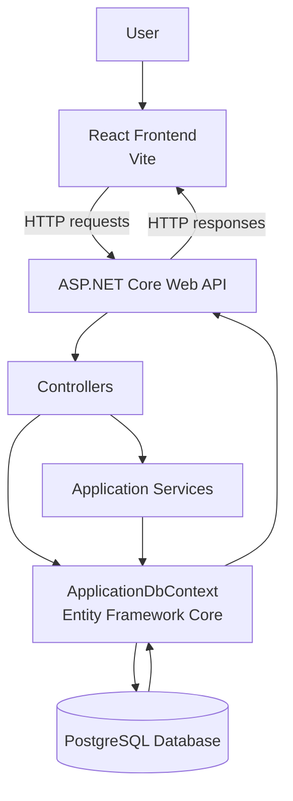
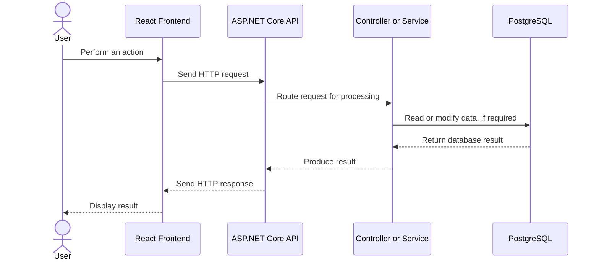

# Sastagram — System Architecture

## 1. Overview

Sastagram is a full-stack social media application built with a React frontend, an ASP.NET Core backend, and a PostgreSQL database.

The application separates the user interface, server-side application logic, and data persistence into distinct components. This structure helps keep frontend interactions separate from backend processing and database operations.

This document describes the system's major components, their responsibilities, and how they interact.

> **Documentation note:** This document is based on the available repository structure. Details such as individual endpoint behaviour, the exact database relationships, media storage implementation, and authorization rules should be verified against the source code.

## 2. Technology stack

| Component | Technology | Responsibility |
|---|---|---|
| Frontend | React | Renders the user interface and handles user interactions |
| Frontend tooling | Vite | Runs the frontend development server and builds frontend assets |
| Backend | ASP.NET Core | Handles API requests and application logic |
| Programming language | C# | Implements backend controllers, services, and data access |
| Database | PostgreSQL | Stores application data |
| Data access | Entity Framework Core | Provides database access and migration functionality |
| Authentication | JWT-related services | Supports token-based authentication |
| Password security | BCrypt-related implementation, if confirmed in the authentication code | Supports secure password hashing |
| Media handling | `MediaService.cs` | Encapsulates media-related functionality; the exact implementation requires verification |

## 3. High-level architecture

Sastagram follows a client–server architecture. The frontend communicates with the backend through HTTP requests, while the backend handles application processing and interacts with the database.



The diagram represents the overall architectural responsibilities. The exact call sequence varies by endpoint; not every controller action necessarily uses a service or accesses the database.

### Component responsibilities

**React frontend**

- Displays application pages and reusable UI components.
- Collects user input and responds to user interactions.
- Sends requests to the backend through frontend service modules.
- Presents data returned by the API.

**ASP.NET Core backend**

- Exposes API endpoints.
- Processes incoming requests.
- Applies application rules and validation implemented by the application.
- Coordinates authentication, service operations, and data access as required.

**PostgreSQL database**

- Provides persistent storage for application data.
- Is accessed by the backend rather than directly by the React frontend.

## 4. Frontend architecture

**Location:** `frontend/Sastagram/`

The frontend is implemented using React and Vite. Its source code is organised into areas for UI components, pages, services, and state management.

| Area | Responsibility |
|---|---|
| Components | Reusable user-interface elements |
| Pages | Page-level views and screens |
| Services | Encapsulates frontend operations such as communicating with the backend |
| Store | Holds or manages application state, according to its implementation |
| Vite configuration | Configures frontend development and build behaviour |

The exact responsibilities of individual files should be documented as the codebase is reviewed.

### Frontend request flow

A typical frontend interaction follows this general sequence:

1. A user performs an action in the interface.
2. A React component or page handles the interaction.
3. The frontend invokes the relevant service or request-handling code.
4. An HTTP request is sent to the backend.
5. The frontend processes the response.
6. The UI updates according to the returned data and application state.

The precise sequence depends on the feature being used.

## 5. Backend architecture

**Location:** `backend/Sastagram/`

The backend is an ASP.NET Core application. Its repository structure separates HTTP controllers, data access, DTOs, domain models, and services.

### 5.1 Controllers

Controllers define the API entry points and handle incoming HTTP requests.

| Controller | Responsibility indicated by its name |
|---|---|
| `AuthController.cs` | Authentication-related operations |
| `PostsController.cs` | Post-related operations |
| `UsersController.cs` | User-related operations |
| `CommentsStoriesNotificationsController.cs` | Operations concerning comments, stories, and notifications |

Controller names indicate their broad areas of responsibility. The exact endpoints and supported operations are documented separately in `api-reference.md`.

### 5.2 Data access

**File:** `Data/ApplicationDbContext.cs`

`ApplicationDbContext` is the Entity Framework Core database context.

Its responsibilities may include:

- Representing the application's database session.
- Exposing entity sets used by the application.
- Configuring entity relationships and database mappings.
- Coordinating persistence operations through Entity Framework Core.

The exact entity sets and relationship configuration should be confirmed from the context implementation.

### 5.3 Data-transfer objects (DTOs)

**File:** `DTOs/Dtos.cs`

Data-transfer objects define the data structures used to transfer information between application layers or across API boundaries, depending on how they are implemented.

DTOs help make request and response contracts explicit and can prevent API contracts from being tied directly to database entity structures.

The actual fields, validation rules, and DTO-to-entity mappings should be documented from the source code.

### 5.4 Models

**Location:** `Models/`

The model files include:

- `Post.cs`
- `Social.cs`
- `User.cs`

These files represent domain or data structures used by the application. Their exact properties, relationships, and persistence mappings must be verified in the code.

### 5.5 Services

**Location:** `Services/`

| Service | Responsibility indicated by its name |
|---|---|
| `TokenService.cs` | Token-related functionality |
| `MediaService.cs` | Media-related functionality |

Services encapsulate functionality that can be invoked by other parts of the backend. Their exact responsibilities, dependencies, and external integrations should be established by inspecting their implementations.

## 6. Database architecture

Sastagram uses PostgreSQL for persistent data storage and Entity Framework Core for backend data access.

The repository contains an `ApplicationDbContext` and Entity Framework Core migration files, including an initial migration and a model snapshot.

### Database interaction

The general data flow is:

1. The backend receives a request.
2. The relevant application code processes the request.
3. Database operations are performed through the configured data-access layer when required.
4. Entity Framework Core communicates with PostgreSQL.
5. The backend processes the result and constructs an appropriate response.

Not all requests require a database operation.

### Database schema

The following source files should be consulted to document the actual schema:

- `Data/ApplicationDbContext.cs`
- `Models/User.cs`
- `Models/Post.cs`
- `Models/Social.cs`
- `Migrations/`

The entity names alone do not establish the complete database schema. Table names, columns, foreign keys, indexes, constraints, and relationships should be taken from the entity configuration and migrations.

### Database migrations

Entity Framework Core migrations provide a versioned representation of database schema changes.

The migration files allow developers to inspect how the database schema is created or changed over time.

Database migrations should be reviewed before being applied to a shared or production database.

## 7. Authentication and security architecture

Sastagram contains an authentication controller and a token service, indicating that authentication and token-related functionality are part of the backend architecture.

The exact implementation must be verified before documenting the complete security model.

### Areas to verify

**Authentication**

- How users register and sign in.
- How credentials are validated.
- How tokens are generated and returned.
- How token expiry is configured.

**Authorization**

- Which endpoints require authentication.
- Whether specific operations require particular roles or resource ownership.
- How authorization policies are applied.

**Password handling**

- Whether passwords are hashed before storage.
- Which password-hashing implementation is used.
- How password verification is performed.

**Configuration and secrets**

- How database credentials and JWT signing keys are configured.
- How media-service credentials are managed.
- Whether sensitive configuration is excluded from source control.

Authentication and authorization are different concerns: successful authentication identifies a user, while authorization determines which operations that user is permitted to perform.

Do not assume that the presence of JWT functionality means every endpoint is protected or that resource-level permissions are enforced.

## 8. Media handling

The backend contains `Services/MediaService.cs`, which indicates a dedicated area for media-related functionality.

The following details should be verified from the implementation before documenting the media architecture:

- Where uploaded media is stored.
- Whether a third-party media provider is used.
- Whether the backend uploads files directly or manages references to existing media.
- How media URLs or identifiers are returned to the frontend.
- How file types, sizes, and upload errors are handled.
- Whether access controls apply to uploaded media.

If an external media provider is used, its role and the location of its credentials should be documented without exposing any secret values.

## 9. Configuration and runtime components

The backend includes the following configuration and startup files:

| File | Purpose |
|---|---|
| `Program.cs` | Application startup and service/middleware configuration |
| `appsettings.json` | Application configuration |
| `appsettings.Development.json` | Development-specific configuration |
| `Properties/launchSettings.json` | Local development launch profiles and URLs |
| `Sastagram.csproj` | Backend project settings and package references |

The frontend includes `vite.config.js`, which configures Vite behaviour.

Configuration values can vary between development, testing, and production. The actual environment-specific settings should be checked before deployment.

**Security consideration:** Never commit real passwords, signing keys, API keys, or other credentials to the repository. Use appropriate secret storage or environment-specific configuration.

## 10. Development request lifecycle

The following diagram illustrates a typical request lifecycle. It is conceptual; individual requests may follow a different path.



The backend may reject a request during routing, authentication, authorization, or validation before any database operation takes place.

## 11. Repository structure

The main architecture-related files are organised as follows:

```text
Sastagram/
├── Sastagram.sln
├── README.md
├── docs/
│   ├── installation.md
│   ├── api-reference.md
│   └── architecture.md
├── backend/
│   └── Sastagram/
│       ├── Controllers/
│       ├── Data/
│       ├── DTOs/
│       ├── Migrations/
│       ├── Models/
│       ├── Services/
│       ├── Program.cs
│       ├── appsettings.json
│       └── Sastagram.csproj
└── frontend/
    └── Sastagram/
        ├── src/
        │   ├── components/
        │   ├── pages/
        │   ├── services/
        │   └── store/
        ├── README.md
        ├── package.json
        └── vite.config.js
```

This is a simplified view of the repository. Additional files and directories may exist.

## 12. Architectural considerations

The current project structure provides a useful separation between the frontend, backend, and persistence layer.

The following considerations should be assessed against the actual implementation:

- **Separation of concerns:** Keep UI rendering, request handling, application logic, and data access appropriately separated.
- **Maintainability:** Keep controllers focused on HTTP concerns and move reusable or complex operations into services where appropriate.
- **Security:** Verify authentication, authorization, input validation, and secret management.
- **Data integrity:** Use appropriate database constraints and transaction handling for operations that require them.
- **Error handling:** Return consistent and useful error responses without leaking internal implementation details.
- **Configuration:** Separate development configuration from production secrets and deployment-specific settings.
- **Testing:** Test API behaviour, validation, authentication, authorization, and database interactions.

These are evaluation areas rather than claims that every measure is already implemented.

## 13. Related documentation

- [`README.md`](../README.md) — Project overview and entry point.
- [`installation.md`](installation.md) — Local development setup and execution.
- [`api-reference.md`](api-reference.md) — API endpoints, parameters, authentication, and responses.
